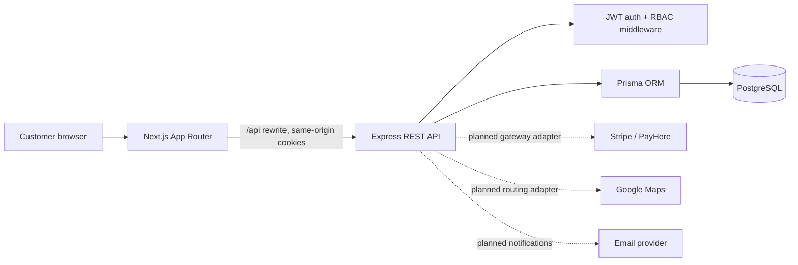

# System Architecture And Workflows

## Architecture

The frontend owns presentation and client-side form feedback. Express owns authorization, validation, fare calculations, booking state transitions and persistence. Prisma owns typed database access. External integrations belong behind API-side adapters so secrets never ship to the browser. The current ride price is a configurable estimate; it is not a map-derived quote.

## Roles

| Role               | Intended access                                                         |
| ------------------ | ----------------------------------------------------------------------- |
| `CUSTOMER`         | Own profile, rides, rentals, orders, reservations, trips and payments   |
| `DRIVER`           | Assigned rides, ride status changes and earnings                        |
| `RENTAL_PROVIDER`  | Own vehicles, availability and rental requests                          |
| `RESTAURANT_OWNER` | Own restaurant, menu, food orders and reservations                      |
| `ADMIN`            | Platform-wide users, providers, catalog, bookings, payments and reports |

Roles are normalized through `Role` and `UserRole`. The current public registration workflow only issues `CUSTOMER`; privileged roles must be granted by an administrative onboarding workflow, not selected in public signup.

## Implemented Customer Workflow

1. A visitor registers with an email, full name and password. The API validates input, hashes the password, creates a customer profile and `CUSTOMER` role, then issues an HttpOnly JWT cookie.
2. The sign-in page can resume a same-origin `next` path after login. `/auth/me` verifies the session for the customer dashboard.
3. A signed-in customer requests a fare estimate. The API applies its configured LKR base and distance rates.
4. The customer submits a ride request. The API recomputes the fare, assigns a unique reference, sets `REQUESTED`, and stores it against the authenticated user.
5. The dashboard lists only that user's ride requests. Logout clears the cookie.

## Planned Booking State Workflows

- Ride: `REQUESTED -> CONFIRMED -> IN_PROGRESS -> COMPLETED`, with `CANCELLED` or `REJECTED` terminal alternatives.
- Vehicle rental: check vehicle date-range conflicts in a serializable transaction, request provider approval, confirm payment, then activate and complete the rental.
- Food order: validate current menu prices and availability, snapshot line prices, then transition through accepted/preparing/ready/delivery states.
- Table reservation: lock/check a table and time slot transactionally before confirming; capacity and overlap constraints must be enforced server-side.
- Trip plan: customer-owned plan with ordered day/stop items; ride and rental references can be attached after those booking workflows exist.
- Payment: create a provider checkout session or payment intent, verify signed webhook events, and update payment/booking state idempotently. Persist provider references and status only; never collect or store raw card data.

Availability checks and payment workflows must be transactional and idempotent before launch. The current schema provides the data foundation but does not implement these planned transitions.
